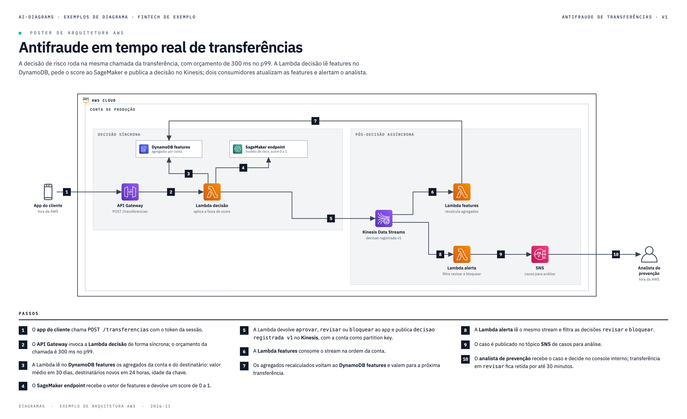

# ai-diagrams

[](LICENSE)
[](https://github.com/viniciuscoimbra/ai-diagrams/commits)


**Descríbelo con palabras. Recibe un diagrama que pasa la revisión.**

[English](README.md) · [Português](README.pt-BR.md)

ai-diagrams es una skill para CLIs de IA (Claude Code, Codex CLI, Kiro CLI). Describes el diagrama en lenguaje natural, o señalas un documento, un DDL o la descripción de un proceso, y la IA escribe la fuente del diagrama, ejecuta un gate geométrico y genera el PNG. El gate rechaza:
- texto superpuesto;
- flechas sueltas o que cruzan cajas;
- badges fuera de la flecha;
- contenido cortado en el borde de la página;
- texto por debajo del tamaño mínimo.

La IA corrige la fuente hasta que el gate pasa, y solo entonces entrega.

La fuente queda en tu repositorio, en texto, y cualquiera puede editarla y volver a generar el PNG.

## Tipos de diagrama

| Tipo | Ejemplo de pedido | Ejemplo |
|---|---|---|
| Póster de arquitectura AWS | "Póster de arquitectura de la API de pagos: API Gateway, Lambda, Aurora y EventBridge." | [prompt y resultado](exemplos/arquitetura-aws/) |
| Flujo con pasos numerados | "Flujo con pasos del outbox al consumidor, con Debezium y MSK." | [prompt y resultado](exemplos/fluxo-passos/) |
| Diagrama de secuencia | "Diagrama de secuencia de la autorización de compra con tarjeta: terminal, red de tarjetas, autorizador, antifraude y ledger." | [prompt y resultado](exemplos/sequencia/) |
| Carriles (swimlanes) | "Flujo en carriles de la apertura de cuenta entre cliente, onboarding, riesgo y operaciones." | [prompt y resultado](exemplos/raias/) |
| BPMN 2.0 (editable en Camunda o bpmn.io) | "BPMN del proceso de disputa de pago." | [prompt y resultado](exemplos/bpmn/) |
| Tabla comparativa | "Tabla que compare SQS, Kinesis y MSK para eventos entre dominios." | [prompt y resultado](exemplos/tabela-comparacao/) |
| Catálogo en tarjetas | "Catálogo en tarjetas de las APIs de la plataforma, con responsable y contrato." | [prompt y resultado](exemplos/catalogo-cards/) |
| Diagrama ER por schema | "Diagrama ER del schema de cobros a partir de este DDL." | [prompt y resultado](exemplos/der-schema/) |
| Matriz de dependencias entre schemas | "Matriz de dependencias entre los schemas de este DDL." | [prompt y resultado](exemplos/matriz-dependencia/) |
| Máquina de estados | "Máquina de estados del ciclo de vida de la tarjeta de débito: solicitada, en emisión, en tránsito, activa, bloqueada, cancelada." | [prompt y resultado](exemplos/maquina-estados/) |
| C4 de contenedores | "C4 de contenedores del sistema de cobro por boleto, con el banco y el ERP fuera." | [prompt y resultado](exemplos/c4/) |



## Requisitos

| Elemento | Para qué | Comprobar |
|---|---|---|
| Python 3.9 o superior | gate y PNG | `python3 --version` |
| Paquete `diagrams` | iconos oficiales de AWS | `python3 -c "import diagrams"` |
| Node 18 o superior | diagrama ER, matriz y máquina de estados | `node --version` |
| Google Chrome | genera el PNG (headless) | `ls "/Applications/Google Chrome.app"` |
| una CLI de IA | Claude Code, Codex CLI o Kiro CLI | `claude --version`, `codex --version` o `kiro-cli --version` |

Instala los iconos con `pip3 install diagrams`. Si Chrome está en otra ruta, indícala en `POSTER_CHROME`.

## Instalación

El paquete npm está preparado localmente y todavía no se ha publicado. Después de la publicación:

```bash
npx ai-diagrams install --claude
npm install -g ai-diagrams
ai-diagrams doctor
```

Usa `--codex` para Codex o `--kiro --projeto /ruta/del/proyecto` para Kiro. Reemplazar una instalación existente requiere confirmación. Para instalar ahora, usa el tarball local descrito en [docs/install.md](docs/install.md) o clona el repositorio:

```bash
git clone https://github.com/viniciuscoimbra/ai-diagrams.git
```

```bash
export AI_DIAGRAMS="$PWD/ai-diagrams"
```

**Claude Code**

```bash
mkdir -p ~/.claude/skills && ln -s "$AI_DIAGRAMS"/skills/ai-diagrams ~/.claude/skills/ai-diagrams
```

**Codex CLI**

```bash
mkdir -p ~/.codex/skills && ln -s "$AI_DIAGRAMS"/skills/ai-diagrams ~/.codex/skills/ai-diagrams
```

Ejecuta Codex con `codex --sandbox danger-full-access`. El sandbox por defecto bloquea Chrome headless, y sin él el gate no se ejecuta.

**Kiro CLI**

```bash
bash "$AI_DIAGRAMS"/ferramentas/instalar-kiro.sh /ruta/de/tu/proyecto
```

Después, dentro del proyecto, ejecuta `kiro-cli chat --agent ai-diagrams`.

Las instrucciones paso a paso están en [docs/install.md](docs/install.md), en inglés. Incluyen el uso sin CLI (Proyectos de Claude.ai, ChatGPT).

## Cómo pedir

Empieza el pedido con "Usa la skill ai-diagrams", para que la IA no responda en texto:

```text
Usa la skill ai-diagrams. Lee docs/decision-antifraude.md y haz el póster de arquitectura AWS
del antifraude en tiempo real, con pasos numerados.
```

La IA elige el tipo y pregunta antes de dibujar cuando el pedido es ambiguo. Después escribe la fuente en `diagramas/_src/`, ejecuta el gate hasta que pase y guarda el PNG en `diagramas/`.

## Importar diagramas y datos existentes

El importador convierte Mermaid (`flowchart`/`graph`, `sequenceDiagram`, `stateDiagram-v2`, `erDiagram`), BPMN 2.0 XML, DDL SQL, catálogos CSV y comparaciones YAML a fuentes nativas y ejecuta el generador y el gate existentes:

```bash
python3 skills/ai-diagrams/scripts/importar.py exemplos/importar/es/sequence.mmd --saida diagramas --idioma es
ai-diagrams importar schema.sql --tipo matriz --saida diagramas --idioma es
```

Los flowcharts con carriles en `subgraph` se convierten en carriles; los demás flowcharts compatibles se convierten en BPMN. La sintaxis no soportada falla con el número de línea, sin descartarse en silencio. `--somente-fonte` prepara las fuentes sin Chrome y deja pendientes el gate completo y el PNG. El importador no traduce el texto del autor. Consulta [sintaxis soportada, límites y ejemplos](docs/importing.md).

## Temas

El color y la fuente vienen de un archivo de tema. La skill trae dos en `skills/ai-diagrams/temas/`: `ai-diagrams` (el predeterminado) y `papel` (papel crema, tinta marrón oscura, Public Sans). Para crear el tuyo, copia `temas/ai-diagrams.json`, cambia los valores de `cores`, `cores_derivadas`, `paleta_der` (colores del DER) y `fontes` (nombre de la familia en Google Fonts) y conserva todas las claves: una clave que falta detiene el build con `TEMA-INCOMPLETO`. Después pasa el tema en cualquier comando, o defínelo una vez:

```bash
python3 skills/ai-diagrams/scripts/build.py diagramas/_src/01-api.html --tema papel
python3 skills/ai-diagrams/scripts/build.py diagramas/_src/01-api.html --tema ./mi-tema.json
export AI_DIAGRAMS_TEMA=./mi-tema.json
```

Un nombre resuelve a `temas/<nombre>.json`; una ruta puede apuntar a cualquier carpeta. El tema cambia color y fuente, nunca la posición de cajas y flechas. Detalles en [docs/how-it-works.md](docs/how-it-works.md#5-theme), en inglés. Al pedir a la IA, di el nombre del tema o adjunta el json.

## Idioma del diagrama

Las etiquetas fijas están disponibles en `pt-BR`, `en` y `es`, en `skills/ai-diagrams/i18n/`. Usa `--idioma es` en el generador y el gate. La prioridad es la flag, después `<meta name="idioma" content="es">` en HTML o `"idioma": "es"` en JSON (también `idioma: 'es'` en el layout DER), después `AI_DIAGRAMS_IDIOMA` y, por defecto, `pt-BR`. Un idioma desconocido falla con `IDIOMA-INEXISTENTE`; una clave ausente del catálogo falla con `IDIOMA-INCOMPLETO`. Los títulos y el contenido del autor deben traducirse en la fuente. Sin selección de idioma, la salida en portugués permanece igual.

## Modelos

La calidad del diagrama depende del modelo. Un modelo débil se equivoca en las coordenadas, necesita más rondas del gate y puede no llegar a cero. Usa un modelo de primera línea. La tabla tipo de diagrama × modelo, solo con lo medido, está en [docs/models.md](docs/models.md). En resumen: en Claude Code, Sonnet 4.5 pasó el gate en los ocho tipos originales; el C4 falló tres veces en Sonnet 4.5 y pasó en Opus 5.5. En Kiro CLI solo se midió una parte de los tipos, y Codex CLI no se midió en este repositorio.

## Licencia

MIT, ver [LICENSE](LICENSE). Las partes de terceros, que son los iconos de AWS, bpmn-js, elkjs y las fuentes (IBM Plex en el tema predeterminado, Public Sans y Source Code Pro en el tema `papel`), siguen sus propios términos, listados en el [README en inglés](README.md#license).
