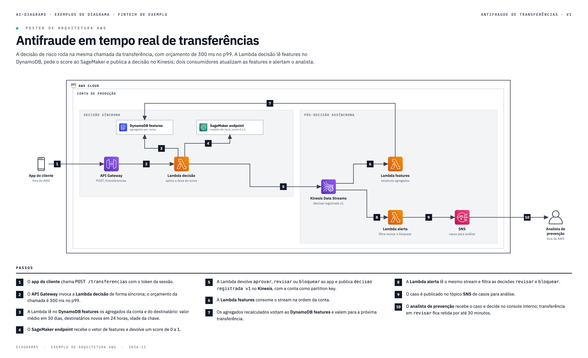
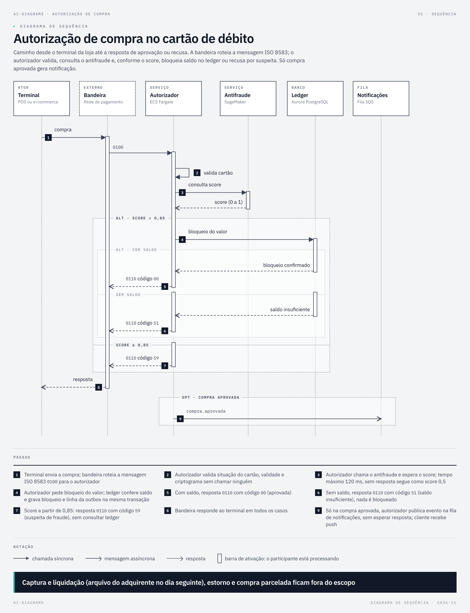
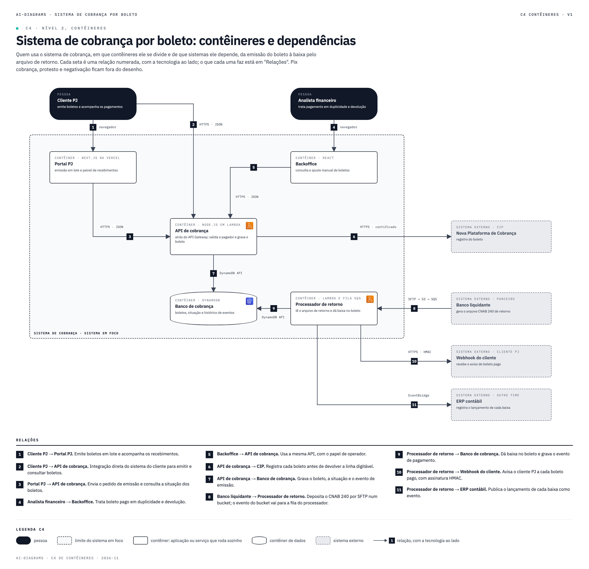

# ai-diagrams

[](LICENSE)
[](https://github.com/viniciuscoimbra/ai-diagrams/commits)


**Describe it in plain words. Get a diagram that passes review.**

[Português](README.pt-BR.md) · [Español](README.es.md)

ai-diagrams is a skill for AI coding CLIs (Claude Code, Codex CLI, Kiro CLI). You describe the diagram in natural language, or point at a document, a DDL or a process description, and the AI writes the diagram source, runs a geometric gate and renders a PNG. The gate rejects overlapping text, loose arrows, arrows crossing boxes, badges off their line, content cut at the page edge and text below a minimum size. The AI keeps fixing the source until the gate passes, and only then delivers.

The source stays in your repository as text, so anyone can edit it and regenerate the PNG later.

## Diagram types

| Type | Example request | Example |
|---|---|---|
| AWS architecture poster | "AWS architecture poster for the payments API: API Gateway, Lambda, Aurora and EventBridge." | [prompt and result](exemplos/arquitetura-aws/) |
| Numbered-step flow | "Step-by-step flow from the outbox to the consumer, with Debezium and MSK." | [prompt and result](exemplos/fluxo-passos/) |
| Sequence diagram | "Sequence diagram of a card purchase authorization: terminal, card network, authorizer, anti-fraud and ledger." | [prompt and result](exemplos/sequencia/) |
| Swimlanes | "Swimlane flow of account opening across customer, onboarding, risk and operations." | [prompt and result](exemplos/raias/) |
| BPMN 2.0 (editable in Camunda or bpmn.io) | "BPMN of the payment dispute process." | [prompt and result](exemplos/bpmn/) |
| Comparison table | "Table comparing SQS, Kinesis and MSK for cross-domain events." | [prompt and result](exemplos/tabela-comparacao/) |
| Cards catalog | "Cards catalog of the platform APIs, with owner and contract." | [prompt and result](exemplos/catalogo-cards/) |
| ER diagram per schema | "ER diagram of the billing schema from this DDL." | [prompt and result](exemplos/der-schema/) |
| Schema dependency matrix | "Dependency matrix between the schemas in this DDL." | [prompt and result](exemplos/matriz-dependencia/) |
| State machine | "State machine of the debit card lifecycle: requested, issued, in transit, active, blocked, cancelled." | [prompt and result](exemplos/maquina-estados/) |
| C4 container diagram | "C4 container diagram of the boleto billing system, with the bank and the ERP outside." | [prompt and result](exemplos/c4/) |







The examples and the skill's built-in instructions are in Portuguese. Write your request in any language: the diagram text follows the language of your request and source material.

## Requirements

| Item | Why | Check |
|---|---|---|
| Python 3.9+ | gate and PNG | `python3 --version` |
| `diagrams` package | official AWS icons | `python3 -c "import diagrams"` |
| Node 18+ | ER diagram, matrix and state machine | `node --version` |
| Google Chrome | renders the PNG (headless) | `ls "/Applications/Google Chrome.app"` |
| an AI CLI | Claude Code, Codex CLI or Kiro CLI | `claude --version`, `codex --version` or `kiro-cli --version` |

Install the icons with `pip3 install diagrams`. If Chrome is somewhere else, set `POSTER_CHROME` to its path.

## Install

```bash
git clone https://github.com/viniciuscoimbra/ai-diagrams.git
```

```bash
export AI_DIAGRAMS="$PWD/ai-diagrams"
```

**Claude Code**

```bash
mkdir -p ~/.claude/skills && ln -s "$AI_DIAGRAMS"/skills/ai-diagrams ~/.claude/skills/ai-diagrams
```

**Codex CLI**

```bash
mkdir -p ~/.codex/skills && ln -s "$AI_DIAGRAMS"/skills/ai-diagrams ~/.codex/skills/ai-diagrams
```

Run Codex with `codex --sandbox danger-full-access`: the default sandbox blocks headless Chrome, so the gate cannot run.

**Kiro CLI**

```bash
bash "$AI_DIAGRAMS"/ferramentas/instalar-kiro.sh /path/to/your/project
```

Then `kiro-cli chat --agent ai-diagrams` inside the project.

Step-by-step instructions, including use without a CLI (Claude.ai Projects, ChatGPT), are in [docs/install.md](docs/install.md). To let an AI agent install it for you, give it [INSTALL.md](INSTALL.md).

## Ask for a diagram

Start the request with "Use the ai-diagrams skill" so the AI does not answer in plain text:

```text
Use the ai-diagrams skill. Read docs/decision-antifraud.md and make the AWS architecture
poster of the real-time anti-fraud check, with numbered steps.
```

The AI picks the type, asks before drawing when the request is ambiguous, writes the source to `diagramas/_src/`, runs the gate until it passes and saves the PNG in `diagramas/`.

## Models

Diagram quality depends on the model. A weaker model gets coordinates wrong, takes more gate rounds and may not reach zero. Use a frontier model. The table of diagram type × model, with only what was measured, is in [docs/models.md](docs/models.md). In short: on Claude Code, Sonnet 4.5 passed the gate on the eight original types; C4 failed three runs on Sonnet 4.5 and passed on Opus 5.5. On Kiro CLI only part of the types was measured, and Codex CLI was not measured on this repository.

## More

| Topic | Where |
|---|---|
| Install, step by step | [docs/install.md](docs/install.md) |
| Generate diagrams from the terminal, without AI | [docs/manual-usage.md](docs/manual-usage.md) |
| How the pipeline works | [docs/how-it-works.md](docs/how-it-works.md) |
| Contributing | [CONTRIBUTING.md](CONTRIBUTING.md) |

## License

MIT, see [LICENSE](LICENSE). Third-party parts keep their own terms:

- AWS icons come from the `diagrams` package installed on your machine and follow the [AWS Architecture Icons](https://aws.amazon.com/architecture/icons/) terms.
- The BPMN viewer in `skills/ai-diagrams/bpmn/vendor/` is [bpmn-js](https://github.com/bpmn-io/bpmn-js), under the bpmn.io license in that folder, which requires the bpmn.io watermark to stay visible.
- The state machine layout in `skills/ai-diagrams/estados/vendor/` is [elkjs](https://github.com/kieler/elkjs) 0.12.0, unmodified, under EPL-2.0 or GPL-3.0-or-later (license in that folder).
- Fonts: IBM Plex Sans and IBM Plex Mono, loaded from Google Fonts, under the SIL Open Font License.
