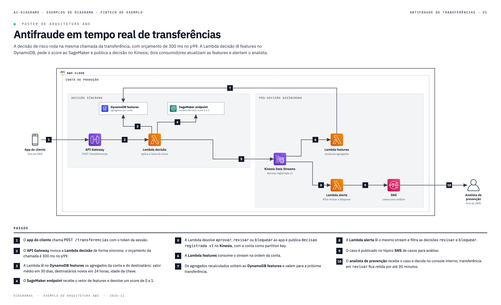

# ai-diagrams

[](LICENSE)
[](https://github.com/viniciuscoimbra/ai-diagrams/commits)


**Descreva em palavras. Receba um diagrama que passa na revisão.**

[English](README.md) · [Español](README.es.md)

ai-diagrams é uma skill para CLIs de IA (Claude Code, Codex CLI, Kiro CLI). Você descreve o diagrama em linguagem natural, ou aponta um documento, um DDL ou a descrição de um processo, e a IA escreve o fonte do diagrama, roda um gate geométrico e gera o PNG. O gate reprova:
- texto sobreposto;
- seta solta ou atravessando caixa;
- badge fora da seta;
- conteúdo cortado na borda da página;
- texto abaixo do tamanho mínimo.

A IA corrige o fonte até o gate passar e só então entrega.

O fonte fica no seu repositório, em texto, e qualquer pessoa edita e gera o PNG de novo depois.

## Tipos de diagrama

| Tipo | Exemplo de pedido | Exemplo |
|---|---|---|
| Poster de arquitetura AWS | "Poster de arquitetura da API de pagamentos: API Gateway, Lambda, Aurora e EventBridge." | [prompt e resultado](exemplos/arquitetura-aws/) |
| Fluxo com passos numerados | "Fluxo com passos do outbox até o consumidor, com Debezium e MSK." | [prompt e resultado](exemplos/fluxo-passos/) |
| Diagrama de sequência | "Diagrama de sequência da autorização de compra no cartão: terminal, bandeira, autorizador, antifraude e ledger." | [prompt e resultado](exemplos/sequencia/) |
| Fluxo em raias | "Fluxo em raias da abertura de conta entre cliente, onboarding, risco e operações." | [prompt e resultado](exemplos/raias/) |
| BPMN 2.0 (editável no Camunda ou no bpmn.io) | "BPMN do processo de contestação de pagamento." | [prompt e resultado](exemplos/bpmn/) |
| Tabela de comparação | "Tabela comparando SQS, Kinesis e MSK para eventos entre domínios." | [prompt e resultado](exemplos/tabela-comparacao/) |
| Catálogo em cards | "Catálogo em cards das APIs da plataforma, com dono e contrato." | [prompt e resultado](exemplos/catalogo-cards/) |
| DER por schema | "DER do schema de cobrança a partir deste DDL." | [prompt e resultado](exemplos/der-schema/) |
| Matriz de dependência entre schemas | "Matriz de dependência entre os schemas deste DDL." | [prompt e resultado](exemplos/matriz-dependencia/) |
| Máquina de estados | "Máquina de estados do ciclo de vida do cartão de débito: solicitado, em emissão, em trânsito, ativo, bloqueado, cancelado." | [prompt e resultado](exemplos/maquina-estados/) |
| C4 de contêineres | "C4 de contêineres do sistema de cobrança por boleto, com o banco e o ERP de fora." | [prompt e resultado](exemplos/c4/) |



## Pré-requisitos

| Item | Para quê | Verificar |
|---|---|---|
| Python 3.9 ou mais novo | gate e PNG | `python3 --version` |
| Pacote `diagrams` | ícones oficiais da AWS | `python3 -c "import diagrams"` |
| Node 18 ou mais novo | DER, matriz e máquina de estados | `node --version` |
| Google Chrome | gera o PNG (headless) | `ls "/Applications/Google Chrome.app"` |
| uma CLI de IA | Claude Code, Codex CLI ou Kiro CLI | `claude --version`, `codex --version` ou `kiro-cli --version` |

Instale os ícones com `pip3 install diagrams`. Se o Chrome estiver em outro lugar, aponte o caminho em `POSTER_CHROME`.

## Instalação

```bash
git clone https://github.com/viniciuscoimbra/ai-diagrams.git
```

```bash
export AI_DIAGRAMS="$PWD/ai-diagrams"
```

**Claude Code**

```bash
mkdir -p ~/.claude/skills && ln -s "$AI_DIAGRAMS"/skills/ai-diagrams ~/.claude/skills/ai-diagrams
```

**Codex CLI**

```bash
mkdir -p ~/.codex/skills && ln -s "$AI_DIAGRAMS"/skills/ai-diagrams ~/.codex/skills/ai-diagrams
```

Rode o Codex com `codex --sandbox danger-full-access`. O sandbox padrão bloqueia o Chrome headless, e sem ele o gate não roda.

**Kiro CLI**

```bash
bash "$AI_DIAGRAMS"/ferramentas/instalar-kiro.sh /caminho/do/seu/projeto
```

Depois, dentro do projeto, rode `kiro-cli chat --agent ai-diagrams`.

O passo a passo completo está em [docs/install.md](docs/install.md), em inglês. Ele inclui o uso sem CLI (Projetos do Claude.ai, ChatGPT).

## Como pedir

Comece o pedido com "Use a skill ai-diagrams", para a IA não responder em texto:

```text
Use a skill ai-diagrams. Leia docs/decisao-antifraude.md e faça o poster de arquitetura AWS
do antifraude em tempo real, com passos numerados.
```

A IA escolhe o tipo e pergunta antes de desenhar quando o pedido é ambíguo. Depois grava o fonte em `diagramas/_src/`, roda o gate até passar e salva o PNG em `diagramas/`.

## Temas

Cor e fonte vêm de um arquivo de tema. A skill traz dois em `skills/ai-diagrams/temas/`: `ai-diagrams` (o padrão) e `papel` (papel creme, tinta marrom-escura, Public Sans). Para criar o seu, copie `temas/ai-diagrams.json`, troque os valores de `cores`, `cores_derivadas`, `paleta_der` (cores do DER) e `fontes` (nome da família no Google Fonts) e mantenha todas as chaves: chave faltando para o build com `TEMA-INCOMPLETO`. Depois passe o tema em qualquer comando, ou defina uma vez:

```bash
python3 skills/ai-diagrams/scripts/build.py diagramas/_src/01-api.html --tema papel
python3 skills/ai-diagrams/scripts/build.py diagramas/_src/01-api.html --tema ./meu-tema.json
export AI_DIAGRAMS_TEMA=./meu-tema.json
```

Nome resolve para `temas/<nome>.json`; caminho pode apontar para qualquer pasta. O tema muda cor e fonte, nunca a posição de caixa e seta. Detalhes em [docs/how-it-works.md](docs/how-it-works.md#5-theme), em inglês. No pedido à IA, diga o nome do tema ou anexe o json.

## Modelos

A qualidade do desenho depende do modelo. Modelo fraco erra coordenadas, gasta mais voltas do gate e pode não zerar. Use um modelo de linha principal. A tabela tipo de diagrama × modelo, só com o que foi medido, está em [docs/models.md](docs/models.md). Em resumo: no Claude Code, o Sonnet 4.5 passou no gate nos oito tipos originais; o C4 reprovou três vezes no Sonnet 4.5 e passou no Opus 5.5. No Kiro CLI só parte dos tipos foi medida, e o Codex CLI não foi medido neste repositório.

## Licença

MIT, ver [LICENSE](LICENSE). As partes de terceiros, que são os ícones AWS, o bpmn-js, o elkjs e as fontes (IBM Plex no tema padrão, Public Sans e Source Code Pro no tema `papel`), seguem os próprios termos, listados no [README em inglês](README.md#license).
